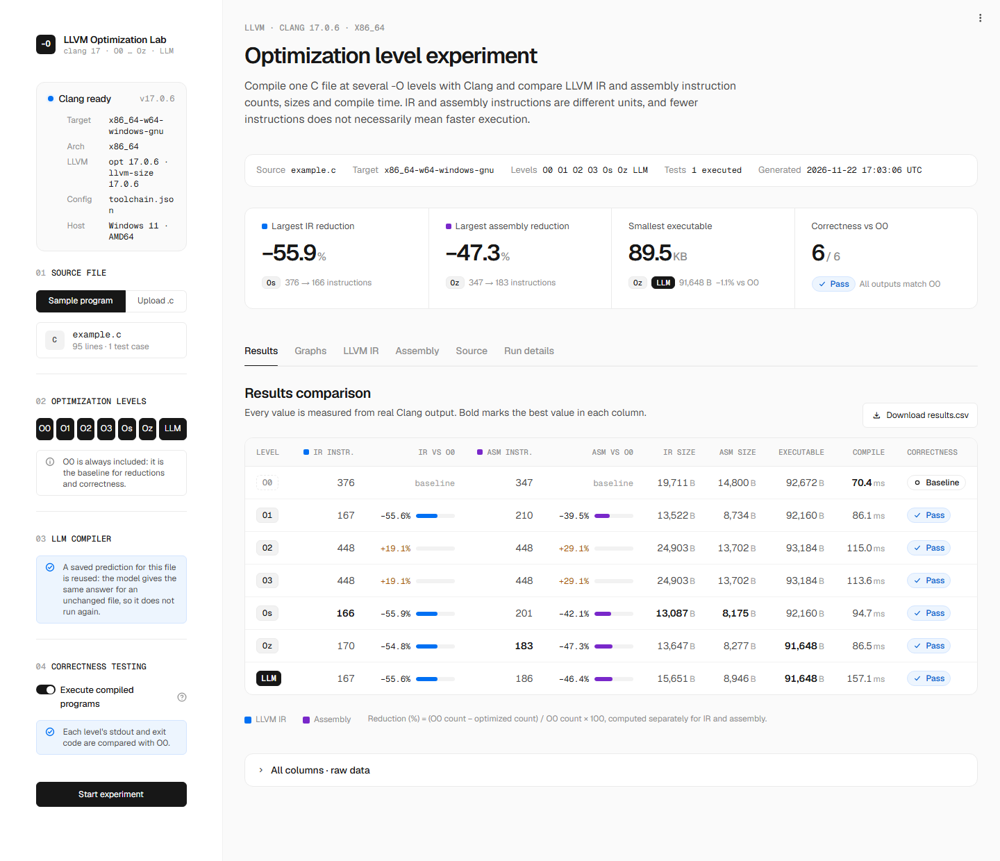
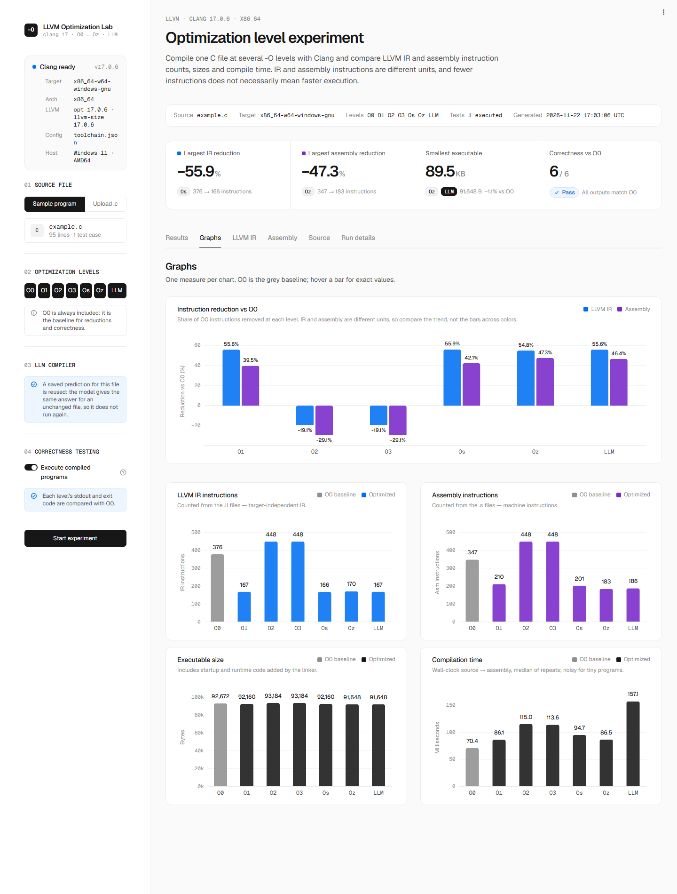
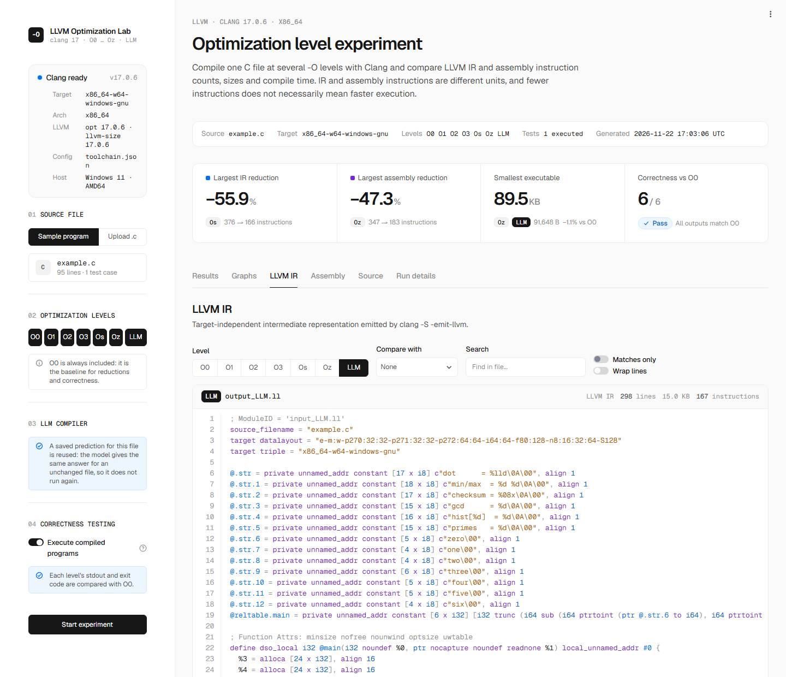
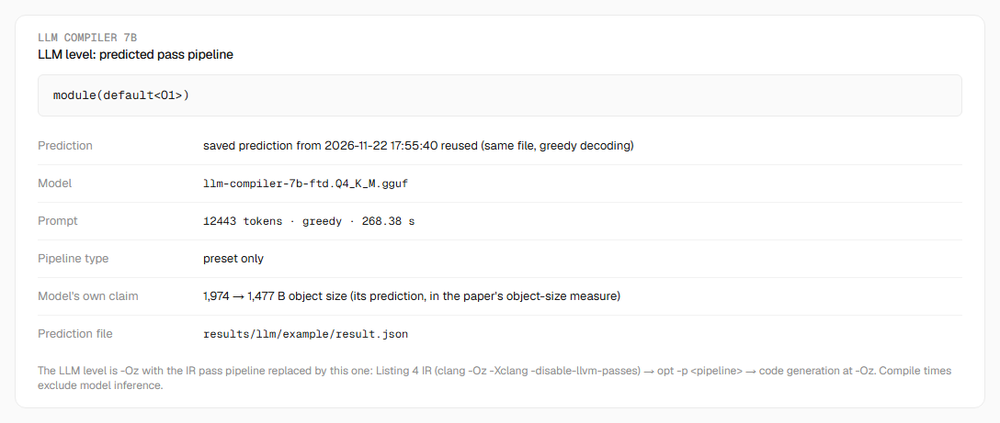

# LLVM Optimization Lab

Compile one C program at every Clang optimization level, **plus a level chosen by an AI model**, and compare what
each one does to the code: LLVM IR and assembly instruction counts, file and executable sizes, compile time, and
whether the program still produces the same output.

| Level | What it is |
|---|---|
| `O0` | no optimization, the baseline everything is compared with |
| `O1` `O2` `O3` | more and more optimization for speed |
| `Os` `Oz` | optimization for small code |
| **`LLM`** | `-Oz` with its optimization pass pipeline replaced by the one **Meta's LLM Compiler 7B** predicts for your file |

Everything runs locally on one pinned toolchain (**Clang/LLVM 17.0.6**, the version LLM Compiler was trained on)
and every number is measured, nothing is estimated. Use it from a **Streamlit dashboard** or with **one command**.



<details>
<summary><b>More screenshots</b>: charts, IR viewer, the model's pipeline</summary>

**Charts**: one measure per chart, O0 in grey.



**LLVM IR / assembly viewer**: every level's output with search and side-by-side compare.



**Run details**: the pass pipeline the model predicted for this file.



</details>

---

## Contents

1. [Requirements](#1-requirements)
2. [Setup](#2-setup)
3. [Run it](#3-run-it)
4. [How it works](#4-how-it-works)
5. [What is measured](#5-what-is-measured)
6. [Reading the results](#6-reading-the-results)
7. [Project structure](#7-project-structure)
8. [Tests](#8-tests)
9. [Troubleshooting](#9-troubleshooting)
10. [Credits and licenses](#10-credits-and-licenses)

---

## 1. Requirements

| | |
|---|---|
| OS | Windows 10/11, x86-64 (the toolchain and llama.cpp builds below are Windows binaries) |
| Python | 3.10 or newer (tested with 3.13) |
| Disk | about 6 GB (model 4.1 GB, llama.cpp 1.3 GB, toolchain 0.5 GB) |
| GPU | optional, for the **LLM** level: an NVIDIA GPU with 6 GB+ VRAM makes the model answer in a few minutes. The CPU build of llama.cpp works too, but slower. |

The O0 … Oz part needs only Python and the clang toolchain (steps 1 to 3 below). The model, llama.cpp and `opt` are
needed only for the **LLM** level.

---

## 2. Setup

The large binaries are **not stored in git**. Each step below puts one of them into its folder; every folder has a
short `README.md` with the exact file names and checksums.

### Step 1: clone and install the Python packages

```powershell
git clone https://github.com/<your-username>/llvm-optimization-project.git
cd llvm-optimization-project
python -m venv .venv
.venv\Scripts\Activate.ps1
pip install -r requirements.txt          # pandas, matplotlib, streamlit, altair, pygments
```

### Step 2: Clang 17.0.6 toolchain (clang, lld, llvm-size, C headers and runtime)

Download `llvm-mingw-20231128-ucrt-x86_64.zip` (135 MB) from the
[llvm-mingw 20231128 release](https://github.com/mstorsjo/llvm-mingw/releases/tag/20231128) ("with LLVM 17.0.6")
and extract its folder as **`toolchains\llvm-mingw-17.0.6-ucrt`**:

```powershell
Expand-Archive llvm-mingw-20231128-ucrt-x86_64.zip -DestinationPath toolchains
Rename-Item toolchains\llvm-mingw-20231128-ucrt-x86_64 llvm-mingw-17.0.6-ucrt
```

No Visual Studio is needed. Do not add it to `PATH`; the project finds it through `toolchain.json`.
Checksum and details: [`toolchains/PROVENANCE.md`](toolchains/PROVENANCE.md).

### Step 3: check

```powershell
python run_all.py --check
```

It prints every tool with its version. With steps 1 and 2 done, the O0 … Oz experiment is ready
(`streamlit run dashboard.py` or `python main.py`). The next three steps add the **LLM** level.

### Step 4: LLVM 17.0.6 `opt`

llvm-mingw does not include `opt`. Get it from the conda-forge package `llvm-tools 17.0.6` and copy `opt.exe` and
its two DLLs into **`llm\tools\llvm17\bin\`**; commands in [`llm/tools/llvm17/README.md`](llm/tools/llvm17/README.md).

### Step 5: llama.cpp server

From the [llama.cpp b12421 release](https://github.com/ggml-org/llama.cpp/releases/tag/b12421) download
`llama-b12421-bin-win-cuda-12.4-x64.zip` and `cudart-llama-bin-win-cuda-12.4-x64.zip` and extract both directly
into **`llm\llama.cpp\`** (so that `llm\llama.cpp\llama-server.exe` exists). No NVIDIA GPU: use
`llama-b12421-bin-win-cpu-x64.zip` instead. Details: [`llm/llama.cpp/README.md`](llm/llama.cpp/README.md).

### Step 6: the model

Download [`llm-compiler-7b-ftd.Q4_K_M.gguf`](https://huggingface.co/QuantFactory/llm-compiler-7b-ftd-GGUF/resolve/main/llm-compiler-7b-ftd.Q4_K_M.gguf)
(4.1 GB) into **`llm\models\`**. It is a 4-bit build of
[facebook/llm-compiler-7b-ftd](https://huggingface.co/facebook/llm-compiler-7b-ftd); accept Meta's license on that
page first. Checksum: [`llm/models/README.md`](llm/models/README.md).

Run `python run_all.py --check` again: every line should say `OK` and `LLM step: ready`.

---

## 3. Run it

### Dashboard (recommended)

```powershell
streamlit run dashboard.py
```

Opens http://localhost:8501. In the sidebar:

1. **Source file**: the bundled `input/example.c`, or upload your own `.c` file (one file with a `main()`).
2. **Optimization levels**: pick any of `O0 O1 O2 O3 Os Oz LLM` (O0 is always included as the baseline).
3. **LLM Compiler** (shown when LLM is selected): status only, nothing to configure. If a llama-server is already
   running it is used; otherwise one is started for the run and stopped afterwards. Asking the model takes a few
   minutes; for an unchanged file the saved answer is reused (the model always gives the same answer).
4. **Correctness testing**: run every compiled program and compare its output with O0.
5. **Start experiment**.

Tabs: **Results** (table + CSV download), **Graphs**, **LLVM IR**, **Assembly**, **Source**, **Run details**
(toolchain, exact commands, the model's pipeline).

### One command

```powershell
python run_all.py                         # input/example.c: ask the model, then build and measure all 7 levels
python run_all.py path\to\prog.c --yes    # your own file (--yes allows running it; see "Safety")
python run_all.py --no-llm                # O0 … Oz only (no model needed)
python run_all.py --dashboard             # open the dashboard afterwards
python run_all.py --check                 # check the setup, run nothing
```

### Experiment only

```powershell
python main.py                                    # input/example.c, O0 … Oz
python main.py prog.c --levels O0 O2 Oz           # a subset
python main.py prog.c --no-run                    # compile and measure, never execute
python main.py prog.c --tests cases.json          # your own test inputs (see below)
python main.py prog.c --llm-result results/llm/prog/result.json   # add the LLM level from a saved prediction
```

### Where things are written

| Folder | Contents | In git? |
|---|---|---|
| `output/<level>/` | `output_<level>.ll`, `.s` and `.exe` of the last run | no |
| `results/` | `results.csv`, `metadata.json`, four PNG charts; `results/llm/<name>/` the model's prompt, reply and `result.json` | no |
| `logs/` | **one log file per run**: `<time>_run_all.log`, `<time>_main.log`, `<time>_dashboard.log`, `<time>_llama-server.log` | no |
| `workspace/` | files uploaded in the dashboard and their outputs | no |

### Safety: running compiled programs

Correctness testing **executes** the programs built from your source, with your permissions and **no sandbox**.
The bundled example runs without asking; for any other file the CLI asks first (or pass `--yes`), and the dashboard
leaves execution off for uploads until you turn it on. `--no-run` always disables execution. Only run code you trust.

### Test inputs

Every executable is run on the same inputs and compared with O0 (stdout and exit code). Inputs come from
`--tests file.json` or from `<source>.tests.json` next to the source; without one, a single run with no arguments
and empty stdin is used:

```json
[ {"name": "n=100", "args": ["100"], "stdin": ""} ]
```

---

## 4. How it works

**Clang** turns C into **LLVM IR** (a CPU-independent intermediate language), an **optimizer** pipeline of passes
rewrites the IR, and a **back end** turns it into assembly and machine code. `-O1 … -Oz` are predefined optimizer
pipelines.

**The O levels**: `clang -O<level>` once each for the `.ll` (IR), the `.s` (assembly) and the executable.

**The LLM level** replaces only the optimizer pipeline:

1. The C file is compiled to unoptimized IR in the form of the paper's Listing 4
   (`clang -Oz -Xclang -disable-llvm-passes`).
2. That module is sent whole to **LLM Compiler 7B FTD** with the paper's prompt (*"Tell me how to optimize this
   LLVM-IR for object file size"*), greedy decoding. It answers with a pass pipeline, e.g.
   `opt -p 'module(default<O1>)'`. LLVM 17 checks that the pipeline is valid.
3. `opt -p <pipeline>` produces `output_LLM.ll`; clang generates assembly and the executable from it at `-Oz`
   without running IR passes again.

The model only chooses passes; it never writes the IR itself, so the LLM level is always valid, correct-by-construction
LLVM output. With `default<Oz>` as the "prediction" this construction gives exactly the `Oz` row (checked by a test),
so every difference between LLM and Oz comes from the model's choice. Method details and the paper reference
(Cummins et al., *Meta Large Language Model Compiler*, arXiv:2407.02524): [`llm/README.md`](llm/README.md).

One toolchain for everything: `toolchain.json` names clang, `opt` and `llvm-size`; before every run each is checked
to report exactly **17.0.6** (clang must target `x86_64-w64-windows-gnu`). Nothing is taken from `PATH`, and there is
no fallback to another compiler.

### The example program

`input/example.c` depends on `argc`, so the compiler cannot pre-compute it and the levels really differ. Measured
with this project:

| Level | IR instr. | Asm instr. | Executable |
|---|---|---|---|
| O0 | 376 | 347 | 92,672 B |
| O1 | 167 | 210 | 92,160 B |
| O2 / O3 | 448 | 448 | 93,184 B |
| Os | 166 | 201 | 92,160 B |
| Oz | 170 | 183 | 91,648 B |
| **LLM** (`default<O1>`) | 167 | 186 | 91,648 B |

O2/O3 grow because they unroll and vectorize loops for speed; the model picked O1's passes, which with -Oz code
generation give 3 fewer IR instructions than Oz and 3 more assembly instructions. In the paper's own measure (object
file text + data) the model's pipeline is 1,444 B vs 1,456 B for -Oz.

---

## 5. What is measured

| Column in `results.csv` | Meaning |
|---|---|
| `opt_level` | `O0`, `O1`, `O2`, `O3`, `Os`, `Oz`, `LLM` |
| `ir_instructions` | LLVM IR instructions in the `.ll` file |
| `asm_instructions` | machine instructions in the `.s` file |
| `ir_reduction_pct`, `asm_reduction_pct` | `(O0 − level) / O0 × 100`; positive = fewer than O0 |
| `ir_size_bytes`, `asm_size_bytes`, `exe_size_bytes` | file sizes |
| `compile_time_s` | wall-clock source → assembly, median of 3 runs (`ir_time_s`, `asm_time_s`, `exe_time_s` too). For LLM: front end + `opt` + code generation, **never the model's thinking time** |
| `correctness` | `BASELINE`, `PASS`, `FAIL`, `SKIPPED (execution disabled)`, `ERROR`, `N/A` |
| `correctness_detail` | which test differed, or why |

`results/metadata.json` adds the tool versions and paths, the source SHA-256, the exact command of every step, the
test inputs and, for LLM, the predicted pipeline, the model and the prompt size.

**Counting.** `src/instruction_counter.py` reads the text files. IR: one per statement inside a `define … { … }`
body; labels, declarations, globals, metadata and debug records are ignored and multi-line instructions count once.
Assembly: lines that are not labels, comments or `.directives`. IR and assembly instructions are different units: only
compare IR with IR and assembly with assembly.

---

## 6. Reading the results

* **Fewer instructions ≠ faster.** `-O3` can be larger and still faster (unrolled, vectorized loops). Runtime is
  not measured.
* **O0 is big on purpose**: every variable lives in memory (`alloca`/`load`/`store`); most of the drop to O1 is that.
* **Constant folding**: if everything is known at compile time, optimized levels shrink the program to a few
  `printf` calls and all levels look the same. Use input-dependent programs (like the example) to see differences.
* **LLM vs Oz** is usually close: the model was trained to beat -Oz on size and its answers build on the standard
  pipelines. It differs on programs with real choices (inlining, unrolling, outlining).
* **Executable size** includes C runtime start-up code, so relative differences look small.
* **Compile time** of small files is mostly process start-up and noisy. LLM runs three tools instead of one, so its
  compile time is about twice the others for that reason alone.
* **PASS** means identical output on your test inputs, not a proof of equivalence. A `FAIL` on correct-looking code
  usually means undefined behaviour or non-deterministic output.

---

## 7. Project structure

```
llvm-optimization-project/
├── dashboard.py            Streamlit dashboard
├── run_all.py              one command: check, ask the model, build and measure every level
├── main.py                 the experiment from the command line
├── toolchain.json          clang / opt / llvm-size paths and the required LLVM version (17.0.6)
├── requirements.txt
├── input/example.c         the example program
├── src/
│   ├── toolchain.py        loads toolchain.json, checks every tool's version and target
│   ├── compiler.py         builds each level (and the LLM level: Listing 4 IR → opt → -Oz code generation)
│   ├── analyzer.py         the experiment: counts, sizes, timing, correctness, CSV, metadata
│   ├── instruction_counter.py   LLVM IR and assembly instruction counters
│   ├── llm_runner.py       starts/stops llama-server, runs llm/get_passes.py, reuses saved predictions
│   ├── runlog.py           one log file per run in logs/
│   └── visualizer.py       PNG charts for the CLI
├── ui/                     dashboard components, charts, code viewer, styles (design: docs/design-system.md)
├── llm/
│   ├── get_passes.py       the paper's method: prompt, decoding, LLVM 17 validation, object size
│   ├── templates/          Meta's chat template for llama-server
│   ├── tests/              offline tests and input modules
│   ├── models/             ← model (download)          llama.cpp/  ← server (download)
│   └── tools/llvm17/       ← opt (download)
├── toolchains/             ← llvm-mingw clang 17.0.6 (download)
├── tests/                  unit tests
├── docs/                   design system, screenshots
└── output/ results/ logs/ workspace/    created by runs (not in git)
```

---

## 8. Tests

```powershell
python -m unittest discover -s tests -v          # counters, pipeline, toolchain checks, the LLM level
cd llm; python -m unittest discover -s tests -v  # LLM Compiler method (stub server, real LLVM 17 tools)
```

They run offline: no model or server is needed. They use the real LLVM 17 tools, so run them after setup steps 2
and 4 (the LLM-level tests in `tests/` are skipped without `opt`).

---

## 9. Troubleshooting

| Message | Fix |
|---|---|
| `The project's LLVM toolchain is not usable` | The message lists the problem (missing file, wrong version, wrong target). Redo setup step 2 or 4. |
| `LLM step: NOT READY` / `model file missing` | Setup steps 5 and 6; `python run_all.py --check` shows what is missing. |
| `the server at … is not serving LLM Compiler` | Another model runs on port 8080. Stop it, or set `LLM_SERVER_URL` to another address. |
| llama-server exits while starting | Out of GPU memory: run `python run_all.py --gpu-layers 10` (or use the CPU build). The server output is in `logs/<time>_llama-server.log`. |
| `the module does not fit the model's context` | The program's IR is larger than the model's 16k-token context. Use a smaller file. |
| `clang --version` in a terminal shows another version | Expected: the project never uses clang from `PATH`. |
| Dashboard shows an error right after updating files | Restart Streamlit (Ctrl+C, `streamlit run dashboard.py`); it keeps old modules in memory. |

Environment variables (optional): `LLM_SERVER_URL` (default `http://127.0.0.1:8080`), `LLM_MODEL_PATH` (default
`llm/models/llm-compiler-7b-ftd.Q4_K_M.gguf`).

---

## 10. Credits and licenses

* [LLVM / Clang](https://llvm.org) 17.0.6: Apache-2.0 with LLVM exceptions.
  [llvm-mingw](https://github.com/mstorsjo/llvm-mingw) by Martin Storsjö.
* [llama.cpp](https://github.com/ggml-org/llama.cpp): MIT.
* [Meta LLM Compiler](https://huggingface.co/facebook/llm-compiler-7b-ftd) (Cummins et al., arXiv:2407.02524):
  Meta's LLM Compiler license. The model file is not part of this repository.
* UI design tokens follow an analysis of Vercel's Geist design language ([`docs/design-system.md`](docs/design-system.md)).

These third-party files are downloaded separately and are not redistributed here. This repository contains only
the project's own code and documentation.
